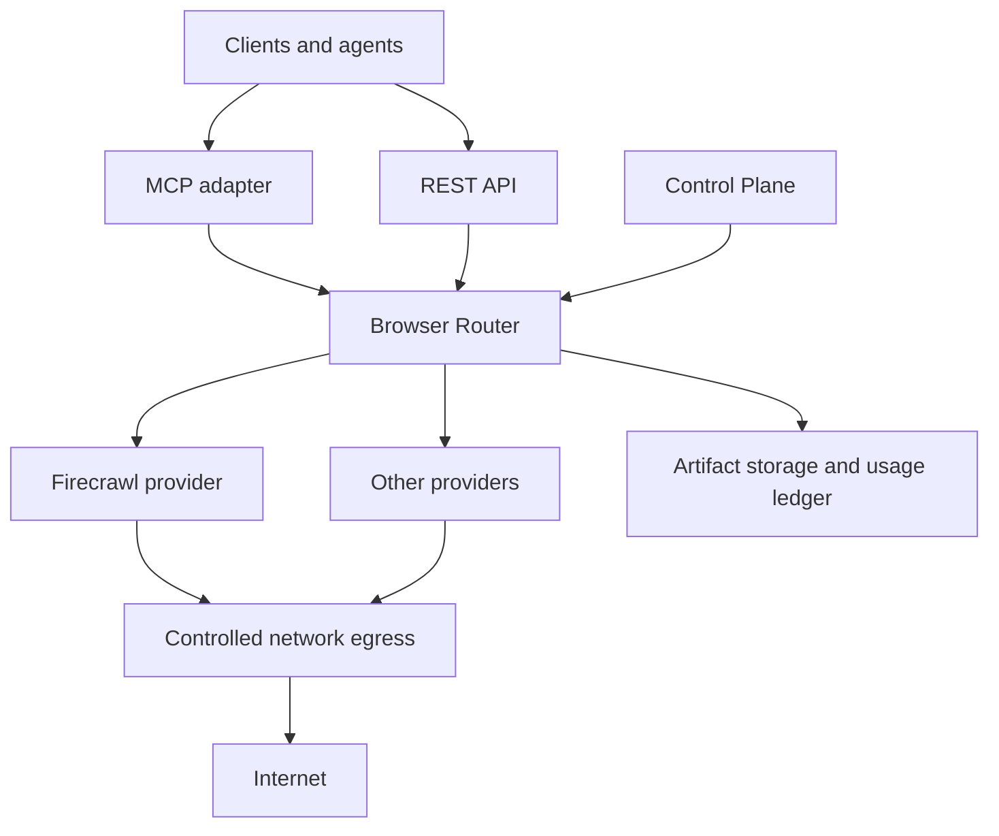

# Workplane Browser Gateway — Engineering Contract

**Version:** 1.0 | **Status:** Proposed implementation baseline

## 1. Mission and delivery strategy

Build an independently deployable, self-hosted, multi-tenant browser acquisition and automation gateway. Deliver Firecrawl first for internal development workloads. Each phase must be independently deployable, documented, tested and accepted. Do not block an earlier release on later commercial features. Do not implement later phases before the preceding acceptance gate without explicit approval.

## 2. Architecture and boundaries

Three logical layers:

1. Control Plane: identity, tenants, API keys, entitlements, provider registry, quotas, usage ledger, billing, administration.
2. Orchestration Plane: protocol-independent Browser Router, REST API and MCP adapter. Both interfaces invoke the same authorization, routing and execution logic.
3. Provider Plane: independently deployable provider services and worker pools. Firecrawl first, then HTTP fetch, Playwright/CDP, optional Crawl4AI, Android and iOS environments.

Cross-cutting services: controlled network egress, artifact storage, observability and secrets. The Browser Gateway acquires and interacts with content; OCR, document inference and general LLM inference belong to Workplane Inference Gateway. Provider-internal extraction needed for scraping is permitted. Do not build an inference gateway in this project.



## 3. Proposed technical baseline

TypeScript/Node.js for gateway services; PostgreSQL for durable control-plane data; Next.js for administration; Docker Compose for initial deployment; S3-compatible storage for large artifacts; Traefik for TLS ingress. Use existing Workplane conventions where available. These are proposed defaults, not mandatory replacements for established repository standards. Firecrawl retains its upstream runtime and dependencies. Pin releases and image digests; never deploy floating latest tags. Do not introduce Kubernetes as a prerequisite.

Suggested repository layout:

```text
apps/api/
apps/mcp/
apps/admin/
packages/contracts/
packages/router/
packages/providers/firecrawl/
packages/policy/
packages/metering/
infra/firecrawl/
infra/gateway/
infra/egress/
docs/runbooks/
tests/integration/
tests/security/
```

## 4. P0 — Firecrawl standalone release (urgent)

### Objective

Deploy a working Firecrawl installation for trusted internal development agents before building the full gateway. This release is not a public multi-tenant product.

### Implementation

- Inspect the current official Firecrawl repository, self-hosting instructions, API specification, license and dependency licenses. Record exact release/commit, supported endpoints, configuration, known limitations and commercial licensing implications in an ADR. Do not assume cloud-only features exist in self-hosted mode.
- Use upstream-supported deployment topology, including its required browser workers, queue, cache and other dependencies. Keep local changes in deployment overlays; do not fork upstream unnecessarily.
- Provide `infra/firecrawl/compose.yaml`, `.env.example`, pinned images/build references, persistent volumes where required, health checks, resource limits, log rotation and restart policies.
- Deploy on a CPU host, independently of inference GPU hosts. Expose only an authenticated HTTPS endpoint through existing ingress, or private VPN access with authentication. Never publish Redis, worker ports or an unauthenticated Firecrawl API. Use an authenticating reverse proxy if upstream self-hosted authentication is insufficient. Store secrets outside Git.
- Preserve native Firecrawl API compatibility for immediate use by existing clients. Document actual base URL and API-key configuration, and provide curl and agent integration examples. If an upstream MCP adapter is compatible, document it as optional; custom MCP development is not a P0 blocker.
- Enable scrape and crawl only where supported and tested; document unsupported operations. Disable optional external paid services and unapproved LLM dependencies by default.
- Set finite request timeouts, crawl depth/page limits, concurrency limits, response-size limits and host CPU/RAM limits. Apply network-level destination restrictions, including loopback, private networks, link-local, cloud metadata and internal services; validate redirects and DNS resolution. Protect IPv4 and IPv6. Use a default-deny egress design with explicitly allowed DNS and web traffic; ensure browser subprocesses cannot bypass it.
- For P0, use a dedicated provider network/host and aggregate network accounting with a hard aggregate transfer ceiling or fail-closed bounded network policy. Per-tenant attribution is deferred. If reliable hard byte caps are unavailable, do not claim a hard budget: restrict to private trusted use, impose conservative job limits and document residual cost exposure for operator approval. Never expose publicly under this exception.
- Document deployment, upgrade, rollback, backup, secret rotation, troubleshooting and stop procedures. Provide an operator kill switch for jobs and network access.

### Acceptance gate P0

| ID | Test | Expected result |
|---|---|---|
| FC-01 | Clean deployment from documented configuration | Healthy services after restart |
| FC-02 | Authorized scrape of controlled HTML fixture | Expected Markdown/text returned |
| FC-03 | JavaScript-rendered fixture | Expected dynamic content extracted |
| FC-04 | Bounded crawl of fixture site | Page/depth limits respected; job reaches terminal state |
| FC-05 | Missing/invalid credential | Access denied |
| FC-06 | Private IP, metadata, redirect and DNS rebinding fixtures | Blocked without contacting forbidden target |
| FC-07 | Slow and oversized fixtures | Bounded execution and documented failure |
| FC-08 | Concurrent requests and worker restart | Bounded resources; recovery behavior documented |
| FC-09 | Native client integration | At least one actual internal dev agent successfully uses service |
| FC-10 | Egress measurement and kill switch | Transfer visible; operator can stop traffic; hard cap verified if claimed |

Release deliverable: deployable stack, actual endpoint/configuration instructions, smoke test results, limitations and rollback procedure. Operator can begin using Firecrawl at this point. Do not wait for P1–P6.

## 5. P1 — Gateway foundation and Firecrawl adapter

Introduce the Browser Router and REST interface without disrupting the P0 endpoint. Use a separate gateway hostname or versioned path. Native endpoint remains restricted to internal operators; after migration, all commercial clients must use the gateway.

### Provider contract

Define versioned typed interfaces and runtime validation. Providers declare supported capabilities, limits, health, asynchronous job support and session support. Unsupported operations return explicit errors; do not pretend every provider implements every capability.

```ts
interface BrowserProvider {
  describe(): Promise<ProviderDescriptor>;
  health(): Promise<ProviderHealth>;
  execute(request: ExecutionRequest): Promise<ExecutionResult>;
  getJob?(jobId: string): Promise<JobStatus>;
  cancel?(jobId: string): Promise<CancelResult>;
}
```

Define schemas for request ID, tenant ID (derived from auth), optional workspace/mission IDs, capability, provider selection, target, typed capability parameters, deadline, constraints and idempotency key. Results include status, provider, provenance, timestamps, artifact references, usage and normalized errors. Do not expose upstream credentials or internal network addresses.

Initial capabilities: `browser.scrape`, `browser.crawl`, `browser.job.get`, `browser.job.cancel` (only if supported). Firecrawl adapter maps supported operations to the pinned upstream API. No provider-specific fields in the common envelope; use validated namespaced options when necessary.

### REST surface (proposed v1)

- `GET /v1/capabilities`
- `POST /v1/scrape`
- `POST /v1/crawls`
- `GET /v1/jobs/{id}`
- `POST /v1/jobs/{id}/cancel`
- `GET /v1/artifacts/{id}` (authorized retrieval)
- `GET /health/live`, `GET /health/ready` (restricted operational detail)

```json
{
  "url": "https://example.com",
  "provider": "firecrawl",
  "formats": ["markdown"],
  "constraints": {"timeoutSeconds": 30, "maxDownloadBytes": 5242880}
}
```

This is a proposed gateway schema, not a native Firecrawl request. Reject constraints that cannot be enforced rather than silently ignoring them. Return 202 for asynchronous work, stable job IDs and documented polling. Use explicit errors such as `UNAUTHORIZED`, `FORBIDDEN`, `UNSUPPORTED_CAPABILITY`, `QUOTA_EXCEEDED`, `PROVIDER_UNAVAILABLE`, `TIMEOUT`, `NETWORK_POLICY_DENIED`, `CANCEL_UNSUPPORTED`. Do not automatically retry side-effecting operations or create duplicate billable jobs. Persist idempotency and job ownership.

Routing: explicit provider or `auto`; filter by entitlement, capability, health, limits and policy. Initially auto resolves to Firecrawl for supported operations. Record routing decisions. No silent fallback for stateful operations or after ambiguous execution.

Acceptance: existing P0 deployment remains functional; gateway integration tests pass; adapter contract tests pass; job ownership enforced; unsupported constraints rejected; provider outage yields bounded failure; no duplicate upstream jobs on repeated idempotency keys.

## 6. P2 — MCP interface and additional core providers

Implement remote MCP using supported Streamable HTTP transport and a pinned official SDK. Authenticate every request, validate origin as applicable, and derive tenant context from credentials. Provide optional stdio bridge for local agents if needed. MCP tools call the same router as REST; no direct provider bypass.

Initial tool names: `browser_scrape`, `browser_crawl`, `browser_job_status`, `browser_job_cancel` when supported. Advertise only entitled and implemented capabilities. Return bounded structured results and artifact references. Treat scraped content as untrusted data, not instructions. Document agent configuration and authentication. Test with at least one real MCP client.

Add independently deployable HTTP fetch and Playwright providers. HTTP fetch must stream with size caps and redirect validation. Playwright must use isolated browser contexts or stronger isolation as required by threat model; no shared cookies or profiles between tenants. CDP can reuse Chromium infrastructure. Expose navigation, screenshot and download capabilities only after corresponding security and lifecycle tests. Do not expose arbitrary browser code execution by default.

Acceptance: MCP and REST parity for shared operations, provider switching without client changes, negative authorization tests, isolation tests and bounded downloads. Firecrawl remains available throughout.

## 7. P3 — Commercial Control Plane

Implement tenant and user management, roles, scoped API keys, provider registry, feature entitlements, plan catalog, quota policies, usage ledger, pricing and admin UI. Reuse established Workplane identity and metering patterns where appropriate, without assuming existing services are available.

Core entities: tenants, users, memberships, api_keys, providers, provider_capabilities, plans, entitlements, quota_policies, jobs, sessions, artifacts, usage_events, budget_reservations, pricing_versions, audit_events. Enforce tenant ownership on every query and operation. Store API key hashes, show plaintext only at creation, support expiry/revocation/rotation. Encrypt provider secrets. Admin actions are audited.

### Metering and billing

Measure requests, pages, network ingress/egress bytes, execution/session duration and concurrency. Distinguish wire bytes from returned content size. Record measurement source, provider, tenant, mission, job, unit, quantity, timestamp and unique event ID. Use immutable usage events and idempotent settlement. Version pricing and use integer minor units or decimal arithmetic. Do not charge twice for provider retries.

Reserve budget atomically before dispatch; enforce during execution; settle actual consumption and release unused reservation. Handle crash recovery and orphaned reservations. Do not claim hard tenant network limits unless traffic can be attributed and terminated at the relevant job/session boundary. Shared Firecrawl pools may require per-job network identities, dedicated workers or tenant-specific pools; aggregate host counters alone are insufficient. Block commercial launch for capabilities lacking required enforceable limits.

Admin UI: tenant management, keys, provider health/configuration, entitlements, usage, quotas, pricing, audit, job inspection and emergency disable controls. No payment processor integration required until explicitly approved; support usage statements and internal chargeback first.

Acceptance: cross-tenant isolation, key revocation, concurrent quota race tests, ledger replay, crash recovery, pricing version tests, network attribution tests, hard limit tests, admin permission tests. No public commercial release until security and licensing review passes.

## 8. P4 — Stateful browser lifecycle

Add session creation, navigation, click, screenshot, close, idle expiry and optional persistent profiles. Bind sessions to tenant and provider; route consistently. Use leases, heartbeats, TTLs, reaper and durable session metadata. Profiles encrypted and isolated; no implicit cross-tenant reuse. Explicit persistence consent and retention policies. Shared stateless pools plus on-demand isolated sessions and optional dedicated capacity. Evaluate Workplane Isolated Workspace integration separately. Test crash cleanup, cancellation, profile isolation and resource reclamation.

## 9. P5 — Mobile environments

Add Android Chrome via emulator/device workers and Appium where appropriate. Distinguish user-agent/viewport emulation from native mobile browsers. iOS Safari and in-app WebView require supported macOS/device infrastructure and suitable host licensing; do not promise Linux-container deployment. Implement real in-app environments only with appropriate app fixtures or authorized device access. Separate device capacity, session and billing metrics. This phase is optional and must not block earlier releases.

## 10. P6 — Distributed capacity and production hardening

Multiple provider hosts, health-aware scheduling, draining, capacity reservations, tenant isolation tiers, distributed coordination, recovery, backup/restore drills, load tests and operational SLOs. Establish measured throughput and cost baselines before promising commercial capacity. Do not introduce uncontrolled retries or session migration that loses state.

## 11. Mandatory cross-cutting security and operations

- Treat URLs, HTML, downloads, scripts and extracted text as untrusted. Do not bypass access controls or site restrictions. Define permitted acquisition policies.
- Enforce SSRF protection at connection/network level, not URL regex alone. Block direct egress bypass, private destinations, metadata endpoints and unauthorized protocols; test redirects, DNS rebinding, IPv6 and proxy behavior.
- No privileged browser containers or host Docker socket access. Run non-root with browser sandbox enabled where supported, drop capabilities, constrain filesystem, CPU, memory and process count. Document exceptions and obtain approval. Container isolation alone is not sufficient for hostile multi-tenant workloads.
- Apply bounded timeouts, cancellation, queue limits, backpressure and retention. Keep credentials and sensitive scraped data out of logs. Store large outputs in authorized object storage with size/TTL limits and provenance.
- Collect structured logs, request IDs, provider latency, error rates, queue depth, worker resource use, traffic and quota violations. Expose health and metrics privately. Define incident and recovery runbooks.
- Verify upstream licenses and commercial hosting obligations for every provider before commercial release. Do not assume self-hosted means unrestricted commercial resale.

## 12. Delivery and reporting protocol

At each phase deliver code, deployment manifests, migrations, configuration examples, API/contract documentation, automated tests, actual test results, security limitations, upgrade/rollback instructions and a concise acceptance report. Distinguish executed tests from planned tests. Use controlled fixtures for deterministic tests and authorized public targets for smoke tests. Never fabricate benchmark or deployment results.

Maintain ADRs and a phase status table. Record decisions that require operator approval. Do not expand scope to Inference Gateway, payment processing, mobile workers or distributed infrastructure during P0. Keep P0 usable while developing later phases. No production cutover without operator acceptance.

## 13. Immediate instruction to the development agent

Start with P0 only. Inspect upstream Firecrawl and existing deployment conventions. Produce the deployable standalone stack, secure ingress, bounded resource/network configuration, smoke tests and internal-agent integration instructions. Report blockers and licensing findings. Stop at the P0 acceptance gate and hand over a usable Firecrawl service. Subsequent phases are the architectural roadmap, not prerequisites for this delivery.

## 14. Decisions pending operator confirmation

Repository name/location, deployment host, DNS hostname, credentials, storage backend, existing identity integration and exact resource ceilings are not supplied. Use configurable placeholders, never invent secrets or claim deployment. Proposed stack, API naming, phase order after P0, pricing units and hybrid provisioning are defaults subject to review. Verify upstream version-specific behavior before implementation. No live infrastructure or upstream repository has been inspected as part of authoring this contract.
